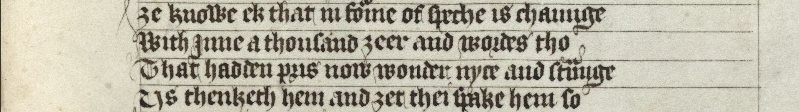
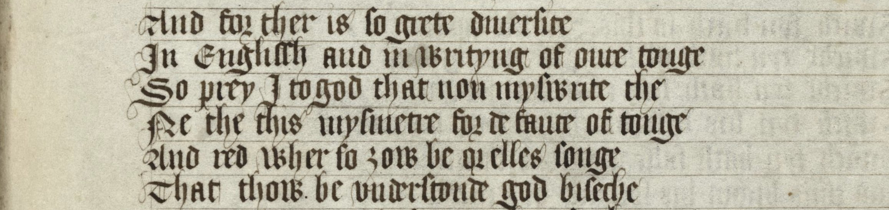
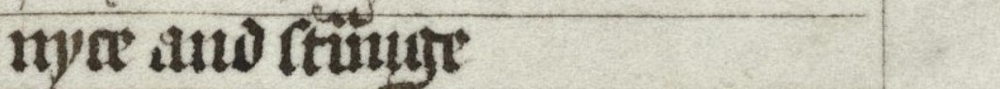
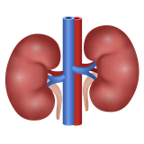

@slide hidden
## Meaning and Structure | The Meaning Part

* *Week 8:* Meaning and the World
* *Week 9:* Meaning and Words
* *Week 10:* Change in Meaning
* *Week 11:* Extending Meaning

---

@slide statement
[**1400s:** That peaceful serving boy made a fool out of their silly young goat’s strength.]{accent}
<!-- .element: class="fragment md-gloss" data-fragment-index="2" -->

The merry knight was fond of their nice kid’s craft.
<!-- .element: class="fragment" data-fragment-index="0" -->

[**Modern:** The cheerful warrior liked their pleasant child’s skill.]{accent}
<!-- .element: class="fragment md-gloss" data-fragment-index="1" -->

--

@slide nohandout
@image ./img/chaucer-troilus-2.jpg fit=cover alt="A page of a fifteenth-century manuscript of Troilus and Criseyde, written in a black textura hand"

--

> Ye knowe ek, that in forme of speche is chaunge\
> With inne a thousand yeer and wordes tho\
> That hadden prys, now wonder nyce and straunge\
> Us thinketh hem and yet thei spake hem so
>
> [You know also that forms of speech will change\
> Within a thousand years, and words\
> That had a value, now wondrous silly and strange\
> We think them, they yet they spoke them so]

@source Chaucer, Geoffrey. c.1385. *Troilus and Criseyde*. Book II, lines 22-25. Manuscript c. 1415-25: Cambridge, Corpus Christi College, MS 061, f. 149r

--

@slide hidden
@image ./img/chaucer-troilus-5.jpg fit=cover alt="A page of the same manuscript of Troilus and Criseyde, from Book V"

--

@slide hidden

> And for ther is so grete diversite\
> In Englissh and in writyng of oure tonge\
> So preye I god that noon miswryte the[e]\
> Ne the[e] mismetre for defaute of tonge\
> And red wher so thou be or elles songe\
> That thou be understonde god beseche

@source Chaucer, Geoffrey. c.1385. *Troilus and Criseyde*. Book V, line 1793-8. Manuscript c. 1415-25: Cambridge, Corpus Christi College, MS 061, f. 149r

--

@slide nohandout
@image ./img/caxton-eneydos.jpg alt="A page of Caxton's printed Eneydos, 1490, in black letter type"

--

@image-left ./img/caxton-eneydos-passage.jpg alt="The same page of the Eneydos, veiled except for the passage beginning ‘And certaynly our langage now vsed’" split=40
> And certaynly our langage now vsed varyeth ferre from that. whiche was vsed and spoken whan I was borne / For we englysshe men / ben [are] borne vnder the domynacyon of the mone. whiche is neuer stedfaste / but euer wauerynge / wexynge one season / and waneth & dyscreaseth another season / And that comyn englisshe that is spoken in one shyre varyeth from a nother.

<em>Prologue</em>. Caxton, William. 1490. <em>Virgil's Booke of Eneydos</em>. London: Printed by William Caxton.

--

@slide nohandout
@image ./img/humboldt-1836.png alt="A printed page of Humboldt's Über die Verschiedenheit des menschlichen Sprachbaues, section 19, in German black letter"

--

@slide smaller
@image-left ./img/humboldt-1836-passage.png alt="The same page of Humboldt, veiled except for the first paragraph of section 19, from ‘Da die Sprache’ to ‘Stillstandes geben’" split=36
> Since language, as I have often noted above, always has only an ideal existence in the heads and minds of men, never a material one, even if engraved in stone or ore, and since the power of language that is no longer spoken, insofar as it can still be felt by us, depends largely on the strength of our own spirit of revival, there can be no moment of true standstill in it any more than in the ceaselessly flaming thoughts of men themselves.

von Humboldt, Wilhelm. 1836. <em>Über die Verschiedenheit des menschlichen Sprachbaues und ihren Einfluss auf die geistige Entwickelung des Menschengeschlechts</em> (=On the Diversity of Human Language Construction and Its Influence on the Mental Development of the Human Species). Berlin: F. Dümmler.

--

@slide nohandout
@image ./img/saussure-1.svg hold id=saussure alt="Two strips from Engler's critical edition of the Cours de linguistique générale, Première partie: Immutabilité et mutabilité du signe, setting the printed text of 1916 beside the students' notes in parallel columns"

--

@image ./img/saussure-2.svg hold id=saussure alt="The same strips with English translations above four passages. Printed text, ‘des rapports: le temps altère toutes choses; il n'y a pas de raison pour que la langue échappe à cette loi universelle’: ...time alters all things; there is no reason why language should escape this universal law. D 225, ‘Invoquons simplement ce fait que nous ne connaissons aucune chose qui ne s'altère dans le temps’: Let us simply invoke this fact that we know of no thing that does not change over time. III C 326, ‘(Invoquons simplement ce fait que) nous ne connaissons aucune chose qui ne s'altère dans le temps’: (Let us simply invoke the fact that) we know of no thing that does not change over time. ‘On peut se référer provisoirement à ce simple fait que toute espèce de chose [qui est] (soumise au) Temps se modifie’: We can refer provisionally to this simple fact that any kind of thing [which is] (subject to) Time is modified…"
@source de Saussure, Ferdinand. 1916. *Cours de linguistique générale*. Eds. Charles Bally & Albert Sechehaye, with Albert Riedlinger. Paris: Payot. de Saussure, Ferdinand. 1968–1974. *Cours de linguistique générale, édition critique.* Ed. Rudolf Engler. Wiesbaden: Harrassowitz.

--

@slide hidden

> Ye knowe ek, that in forme of speche is chaunge\
> With inne a thousand yeer and wordes tho\
> That hadden prys, now wonder **nyce and straunge**\
> Us thinketh hem and yet thei spake hem so
>
> [You know also that forms of speech will change\
> Within a thousand years, and words\
> That had a value, now wondrous **silly and strange**\
> We think them, they yet they spoke them so]

@source Chaucer, Geoffrey. c.1385. *Troilus and Criseyde*. Book II, lines 22-25. Manuscript c. 1415-25: Cambridge, Corpus Christi College, MS 061, f. 149r

---

## Semantic Change

* **Saussure:** “[…] time alters all things; there is no reason why language should escape this universal law.”
* **Sapir:** “Language moves down time in a current of its own making.”
* So words naturally change their meaning; language is not a fossil
* How do words change meaning?

--

@slide statement
[**1400s:** The cold peasant was satisfied because her uneducated godparent looked truly skilful.]{accent}
<!-- .element: class="fragment md-gloss" data-fragment-index="2" -->

The cool villain was sad because her lewd gossip appeared very artificial.
<!-- .element: class="fragment" data-fragment-index="0" -->

[**Modern:** The admirable scoundrel was sorrowful because her sexually-explicit rumours seemed intensely fake.]{accent}
<!-- .element: class="fragment md-gloss" data-fragment-index="1" -->

--

## Semantic Changes

@quote attrib="Durkin, Philip. 2009. *The Oxford Guide to Etymology*. Oxford: Oxford University Press. 222–3."
Semantic changes are notoriously difficult to classify or systematize […] Additionally, semantic change is much more closely connected with change in the external, non-linguistic world, especially with developments in the spheres of culture and technology.

--

@slide nohandout
@image ./img/changes-a-0.svg hold id=changes-a alt="The sentence ‘The cool villain was sad because her lewd gossip appeared very artificial.’, with cool, villain, sad, lewd, gossip, very and artificial in black and the other words in grey"

--

@slide nohandout
@image ./img/changes-a-1.svg hold id=changes-a alt="Above the sentence, linked to the word cool: cool: cold → admirable"

--

@slide nohandout
@image ./img/changes-a-2.svg hold id=changes-a alt="Above the sentence, linked to the word villain: villain: peasant → scoundrel"

--

@slide nohandout
@image ./img/changes-a-3.svg hold id=changes-a alt="Below the sentence, linked to the word sad: sad: satisfied → sorrowful"

--

@slide nohandout
@image ./img/changes-a-4.svg hold id=changes-a alt="Below the sentence, linked to the word lewd: lewd: uneducated → sexually-explicit"

--

@slide nohandout
@image ./img/changes-a-5.svg hold id=changes-a alt="Under the label for cool: becoming positive, metaphorical"

--

@slide nohandout
@image ./img/changes-a-6.svg hold id=changes-a alt="Under the label for villain: becoming negative, more precise"

--

@slide nohandout
@image ./img/changes-a-7.svg hold id=changes-a alt="Under the label for sad: becoming negative"

--

@image ./img/changes-a-8.svg hold id=changes-a alt="The sentence ‘The cool villain was sad because her lewd gossip appeared very artificial.’ with four words labelled: cool: cold → admirable, becoming positive, metaphorical; villain: peasant → scoundrel, becoming negative, more precise; sad: satisfied → sorrowful, becoming negative; lewd: uneducated → sexually-explicit, becoming negative"

--

@slide nohandout
@image ./img/changes-b-0.svg hold id=changes-b alt="The sentence ‘The cool villain was sad because her lewd gossip appeared very artificial.’, with cool, villain, sad, lewd, gossip, very and artificial in black and the other words in grey"

--

@slide nohandout
@image ./img/changes-b-1.svg hold id=changes-b alt="Above the sentence, linked to the word gossip: gossip: godparent → rumours"

--

@slide nohandout
@image ./img/changes-b-2.svg hold id=changes-b alt="Under the label for gossip: becoming negative, more general"

--

@slide nohandout
@image ./img/changes-b-3.svg hold id=changes-b alt="Below the sentence, linked to the word very: very: truly → intensely"

--

@slide nohandout
@image ./img/changes-b-4.svg hold id=changes-b alt="Under the label for very: becoming grammatical"

--

@slide nohandout
@image ./img/changes-b-5.svg hold id=changes-b alt="Below the sentence, linked to the word artificial: artificial: skilful → fake"

--

@image ./img/changes-b-6.svg hold id=changes-b alt="The sentence ‘The cool villain was sad because her lewd gossip appeared very artificial.’ with three words labelled: gossip: godparent → rumours, becoming negative, more general; very: truly → intensely, becoming grammatical; artificial: skilful → fake, becoming negative"

--

## Types of Semantic Change

* Becoming positive (*cool*)
* Becoming negative (*sad*)
* Becoming more general (*gossip*)
* Becoming more precise (*villain*)
* Becoming grammatical (*very*)
* Metaphor and metonymy (*cool*)

---

## Amelioration and Pejoration

* **Amelioration** (or elevation): more positive
  * *nice* (foolish → pleasant)
  * *sophisticated* (artificial → refined)
  * *knight* (servant → nobleman)
* **Pejoration** (or deterioration): more negative
  * *silly* (blessed → foolish)
  * *vulgar* (common → crude)
  * *wench* (child → servant)

--

## Case Study: *silly*

@table widths=22,26,30,22
| *Old English* | *Middle English* | *Early Modern English* | *Modern English* |
|---|---|---|---|
| {++[happy]{gold}++} | | | |
| {++[fortunate]{gold}++} | | | |
| {++[blessed]{gold}++} | {++[→]{gold} [pious, holy]{green}++} | | |
| | {++[innocent, harmless]{green}++} | | |
| | {++[weak, pitiable]{green}++} | {++[→]{green} [simple, ignorant]{purple}++} | |
| | | {++[feeble-minded]{purple}++} | {++[→]{purple} [foolish, stupid]{red}++} |

--

## Broadening and Narrowing

* **Broadening** (or widening): more general
  * *dog* (specific breed → any canine)
  * *salary* (salt payment → any payment)
  * *bird* (small birds → all avian species)
* **Narrowing** (or specialization): more precise
  * *meat* (any food → animal flesh)
  * *deer* (any animal → specific species)
  * *starve* (any death → death by hunger)

--

## Grammaticalization

* Grammaticalization: becoming grammatical
* More precisely: content word → function word
  * *have to* lexical possession → modal obligation
  * *while* noun meaning ‘time’ → subordinating conjunction
  * *like* adjective meaning ‘similar’ → discourse marker, quotative
  * *because* PP ‘by cause’ → subordinating conjunction
  * *away* OE ‘on weg’, PP ‘on one’s way’ → adverb

--

## Metaphor and Metonymy

* Next week! Change through similarity and association:
  * *sweet* (taste → personality)
  * *sharp* (edge → intelligence)
  * *bitter* (taste → emotion)
  * *suits* (clothing → businesspeople)
  * *press* (machine → media)
* Can happen with whole domains:
  * In psychology, many physical metaphors (*depression, projection, defense, pressure, breakthrough, burnout, perspective, falling apart*)

--

## Chains

* Like with *silly*, these changes are often chained in complex ways:
  * *navigate* (sail a vessel → move between physical obstacles → move between figurative obstacles → use a website)
  * *awful* (inspiring awe → worthy of respect → impressive → frighteningly impressive → dreadful, monstrous → very bad)
  * *bully* (sweetheart → fine fellow → protector, champion → swaggering person → intimidator → harasser)
  * *heart* (organ → emotional centre → to love/like → like/favourite symbol → digital interaction)

---

## Why do meanings change?

* *External forces* such as new things in the world shift word meanings (so *wireless* meaning 📻 *radio*, common in the early and mid twentieth century, now often means technology without cords, as in ⌨️ *wireless keyboard*)
* *Internal forces* such as metaphor, or systemic regulation (OE/ON 👗 *skirt*/👚 *shirt*; homonymic clash in Northern English and Scots  *neer/kidney*, 👂 *ear/lug*)

--

## Evidence

@image ./img/oed-sophisticated.png hold id=oed-sophisticated alt="The OED Online entry for sophisticated, adjective, open at Meaning and use, with the first sense ‘Mixed with some foreign substance; adulterated, not pure or genuine’ and its quotations from 1607"

--

## Evidence

* You should use OED citations to see examples in use (remember meanings exist only in use). So:
* *naughty*, adjective
  * Having or possessing nothing; poor, needy (c.1450 ‘More nedyer and nauȝtier’)
  * Having no morals; morally bad or wicked (from C15th; 1677 ‘A most vile, flagitious man, a sorry and naughty Governour as could be’)
  * Sexually provocative (from C16th; 1675 ‘the naughty Town Women, who only hate their Husbands, and love every Man else’)
  * Mischevious or disobedient (from C17th; 1889 ‘behaves like a very naughty child’)

--

## Words and meanings

* There are approximately 3.4 *forms* for each *concept*, on average, over the last millennium of English (804,830 words and 235,249 meanings).
* We know this due to the *Historical Thesaurus of English* ([ht.ac.uk](https://ht.ac.uk)), a research project at Glasgow since 1965, which arranges all the word forms in English according to their meaning.
* It is ‘a magnificent achievement of quite extraordinary value. It is perhaps the single most significant tool ever devised for investigating semantic, social, and intellectual history’ (Lord Randolph Quirk).

--

@image ./img/ht-browse-1.png alt="The Historical Thesaurus of English website, browsing the category 03.10.04 n. Rail travel: the hierarchy of Society and Travel and travelling on the left, the words for rail travel and its subcategories on the right"

--

@slide fade
@image ./img/ht-browse-2.png alt="Further down the same Historical Thesaurus page: the Air/space travel part of the hierarchy, with Balloons and airships highlighted, beside the words for types of balloon, a balloon attached to a wire, and airship"

--

@slide fade
@image ./img/ht-browse-3.png alt="Further down again: the words for an airship, from ship (1679) and airship (1819) to Zeppelin and zep(p), and the subcategory types of airship, with blimp"

--

@slide fade
@image ./img/ht-timeline-transport.png alt="The Historical Thesaurus timeline for 03.10.02 n. Transport: one bar per word, from carriage, portage and carrying to vecture and wafting, showing when each was in use"

--

@slide fade
@image ./img/ht-homepage.png alt="The home page of the Historical Thesaurus of English website" caption="www.ht.ac.uk"

---

@slide fade
## Recent Language Change

* Punctuation becoming lexical items:
* ‘Don’t *at* me.’
  * I’ve spent countless dollars on cushions and pillows that didn’t quite meet the approval of my neurotic hound mix, Leona, ending up shredded to pieces or, at best, ignored. Having a big pooch also means their furniture is going to be big, so you might as well pick an option or three (yes, Leona has three, don’t at me) you don’t hate looking at[…] %%*Architectural Digest,* ‘The Best Dog Beds for Your Furry Best Friend’, January 2024%%
* ‘He’s her boyfriend *slash* therapist’
  * One use: the first part intended versus the second part actual.
  * Another use: hesitation or blending. ‘It’s a library slash cafe’, ‘It’s strawberry slash tangerine or something?’

---

## Follow-up

@pause
* As well as general reading from the reading list, you should have a look at chapters 4 and 5 from:
  * Kay, Christian & Kathryn Allan. 2015. *English Historical Semantics*. Edinburgh: Edinburgh University Press. (As always, available as an ebook via the library.)
* If you have questions, talk to your tutor or do please come see me (email me for a time!)
