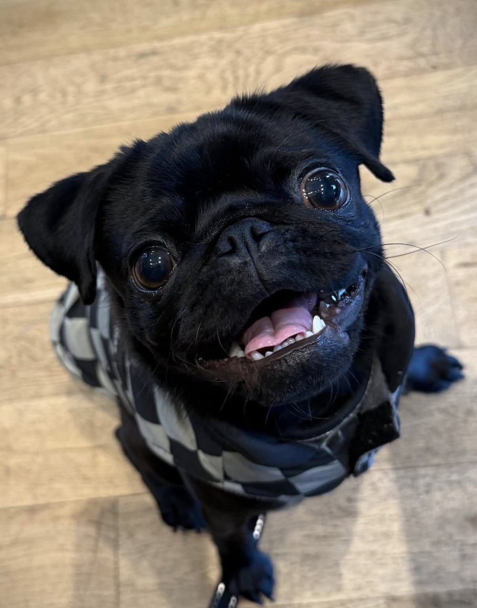

## Meaning and Structure | the meaning part

* *Week 8:* Meaning and the World
* *Week 9:* Meaning and Words
* *Week 10:* Change in Meaning
* *Week 11:* Extending Meaning

---

## Meaning and Grammar

* **Closed class words:** pronouns, conjunctions, auxiliary verbs, determiners, prepositions, etc
* **Open class words:** nouns, verbs, adverbs, and adjectives
* The closed classes often carry a **grammatical meaning** (‘this is in the future’, ‘this is definite’, ‘these things are alternates’, ‘this is certain’, ‘this is on top of something else’); these are meanings which function to indicate relationships between open-class words
* The open classes often carry a **lexical meaning**…

--

@slide morph static
## Lexical Meaning

* **Closed class words:** pronouns, conjunctions, auxiliary verbs, determiners, prepositions, etc
* **Open class words:** nouns, verbs, adverbs, and adjectives
* The closed classes often carry a **grammatical meaning** (‘this is in the future’, ‘this is definite’, ‘these things are alternates’, ‘this is certain’, ‘this is on top of something else’); these are meanings which function to indicate relationships between open-class words
* The open classes often carry a **lexical meaning**…

--

@image-seq
  ./img/oed-wing.png alt="The OED Online entry for wing, noun, open at its etymology and first sense"
  ./img/oed-punch.jpg alt="The OED Online entry for punch, verb, showing its quotations"
  ./img/oed-trebuchet.png alt="The OED Online entry for trebuchet, noun, a medieval siege engine"
  ./img/oed-cloudy.png alt="The OED Online entry for cloudy, adjective, with its Old English quotations"
  ./img/oed-zoom.png alt="The OED Online entry for Zoom, verb, to communicate by video call, with quotations from 2014 to 2020"

--

## Lexical Meaning

@quote attrib="Leech 1981: ix"
Why study semantics? Semantics (as the study of meaning) is central to the study of communication; and as communication becomes more and more a crucial factor in social organization, the need to understand it becomes more and more pressing. Semantics is also at the centre of the study of the human mind – thought processes, cognition, conceptualization – all these are intricately bound up with the way in which we classify and convey our experience of the world through language.

--

## Lexical Meaning

@quote attrib="Saeed 2003: 6"
If we ask where the meanings of words exist, the answer must be: in the minds of native speakers of the language.

---

@image-right ./img/banana.jpg alt="A banana" split=24
## How Do Words *Mean*?

* Words – like *banana* – have a relationship between the word as a thing made up of letters and sounds and the thing in the world it refers to.
* Debates about the relationship between words and things take into account:
  1. The *form* of the word (its sound or written image)
  2. The *referent* (the thing to which the word refers)
  3. The *concept* (the mental abstraction which the form articulates)

--

## How Do Words *Mean*?

@image ./img/triangle-01.svg hold id=triangle alt="The labels concept, form and referent, set out as the corners of a triangle"

--

## How Do Words *Mean*?

@image ./img/triangle-02.svg hold id=triangle alt="Under form: the written form banana and the spoken form /bəˈnɑːnə/"

--

## How Do Words *Mean*?

@image ./img/triangle-03.svg hold id=triangle alt="An arrow from form up to concept"

--

## How Do Words *Mean*?

@image ./img/triangle-04.svg hold id=triangle alt="Above concept, a head with a banana in mind"

--

## How Do Words *Mean*?

@image ./img/triangle-05.svg hold id=triangle alt="An arrow from concept down to referent"

--

## How Do Words *Mean*?

@image ./img/triangle-06.svg hold id=triangle alt="Under referent, a photograph of bananas"

--

## How Do Words *Mean*?

@image ./img/triangle-07.svg hold id=triangle alt="A dotted line joins form and referent along the base of the triangle"

--

## Where is the *word*?

@image ./img/triangle-08.svg hold id=triangle alt="The label word, to the left, with arrows to concept and to form"

--

## The Semiotic Triangle

@image ./img/triangle-09.svg hold id=triangle alt="The semiotic triangle: concept at the top, form and referent at the base joined by a dotted line, word pointing to concept and form"

--

## The Semiotic Triangle

@image ./img/triangle-10.svg hold id=triangle alt="The semiotic triangle with the alternative terms: concept (or signified), form (or signifier), word (or sign)"

---

## Form and Referent

* The relationship between the *form* and the *referent* is a dashed line because there is (usually) **not a direct relationship** between the word’s form and its referent

--

@image ./img/pug-dog-label.jpg alt="A pug sitting on a wooden floor with a paper label reading DOG on its head"

--

## Form and Referent

@columns widths=30,40,30
* English: *dog*
* Dutch: *hond*
* Finnish: *koira*
* German: *Hund*
* Hawaiian: *ʻīlio*
* Icelandic: *hundur*
* Italian: *cane*
::

::
* Japanese: *犬*
* Mandarin: *狗*
* Korean: *개*
* Arabic: *الكلب*
* Hebrew: *כֶּלֶב*
* Greek: *σκύλος*
* Russian: *собака*
@end

---

## *Usually* not a relationship

* Sometimes there *is* a relationship between the two:
  * **Onomatopoeia**, which means the mimicry of a concept by a word, such as *bang, splash, quack*, etc.

--

@image ./img/chapman-duck.jpg alt="A comic by James Chapman, How to sound like a duck in 7 languages: quack, rap, mac, háp, coin, vak and praaks"

--

## *Usually* not a relationship

* Sometimes there *is* a relationship between the two:
  * **Phonaesthesia**, which means when words expressing similar concepts share some characteristics of form
  * Many English words referring to a reflection of light from a surface begin with *gl-* (including *glint, glisten, gleam, glitter, glow*)
  * Many words to do with uncomfortable or twisting movement begin with *wr-* (including *writhing, wrenching, wresting, wringing, wreathing, wrying, writher, wriggle, wrinkle*)
  * Many words to do with wetness often begin with *sl-* (including *slurp, slake, slobber, slippery, slime, slop, slush, sludge, slide, sledge, slick, slither, slope, slalom*), etc.

---

## How do you define a word?

* Because of the semiotic triangle, we know that we define words by combining a *concept* and a *form*.
* So when confronted with a form, we can refer to the concept by:
  * describing a set of characteristics of the concept, or
  * by pointing to a typical example (this is an *ostensive definition*)
* The concept part of a word does not lie itself in the examples, but through encountering examples we can come up with that concept. (And sometimes update it, as we’ll see in week 10.)

--

## Finding Examples

* When you give an ostensive definition, what example do you choose?
* Draw a *tree* so that you can use it as an ostensive definition.

--

@image ./img/dragons-blood-tree.jpg fit=cover alt="Dragon's blood trees, with their umbrella-shaped crowns, on a rocky hillside" caption="Dragon’s blood tree (*Dracaena cinnabari*)"

--

@image ./img/joshua-tree.jpg fit=cover alt="Joshua trees silhouetted against a cloudy evening sky" caption="Joshua tree (*Yucca brevifolia*)"

--

@image ./img/oak-tree.jpg fit=cover alt="A broad oak tree standing alone in a green field"

--

## Finding Examples

* What about a *house*?

--

@image ./img/child-drawing-house.jpg alt="A child's drawing of a yellow two-storey house with a chimney, two children and the sun" caption="Wikimedia Commons"

--

## Prototypes

* How many of you actually live in a house like this?
  * Detached
  * Two stories
  * Smoke coming from a chimney
* How many of you would say things like “I’m going back to the house now” when you mean a flat?
* What is the definition of a *house*?

--

@image ./img/oed-house.png alt="The OED's first definition of house, noun: a building for human habitation, typically and historically one that is the ordinary place of residence of a family"

---

## Prototypes

* Shared typical features of a *set* create a *categorisation*
* We do this through our experience of the world as speakers
* But not all members are equally typical of the set
* Central, typical, members of a set are called prototypes
* We can usually get agreement from speakers of a particular variety as to the central members of a set

--

## Vegetables

* Write down the first three typical vegetables you can think of
* When this experiment was done with US college students: {answer *carrot, pea, corn, bean, potato, tomato, lettuce, spinach, asparagus, broccoli*}

--

## Prototypes

* Prototypes represent categories of sets
* Almost all sets are *fuzzy*
* Items on the edges of a fuzzy set can be arguable:
  * Centre of the set we call *birds*: sparrow, robin, blackbird, crow
  * Edge of the set: ostrich, penguin
  * Share some characteristics but definitely not: bats, aeroplanes
  * Have an argument over: dinosaurs

--

@image ./img/birdlife-dinosaurs.jpg alt="A BirdLife International article, 21 December 2021, headed It's official: birds are literally dinosaurs. Here's how we know, with an illustration of a feathered dinosaur" caption="BirdLife International, 21 December 2021"

--

@compare
  ./img/velociraptor-scaly.png alt="A velociraptor drawn as a scaly reptile, in the style of older reconstructions"
  ./img/velociraptor-feathered.jpg alt="A velociraptor restored with feathers, in the style of current reconstructions"

---

## Follow-up

* This week, you should look under the *Meaning* heading in the online reading list (on Moodle) and sample a few introductory chapters from books on semantics.
* If you have questions, talk to your tutor or do please come see me (email me for a time!).
